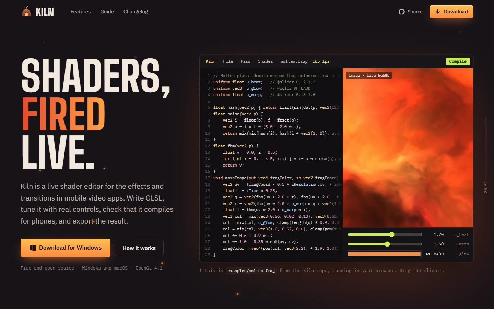
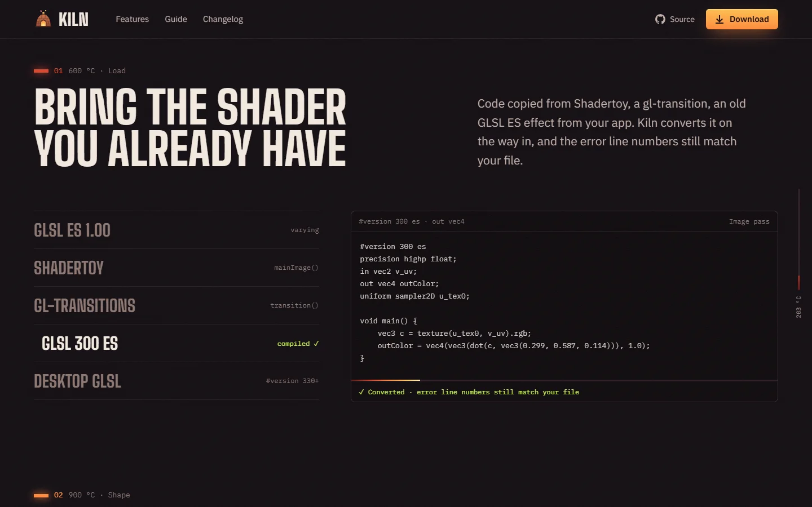
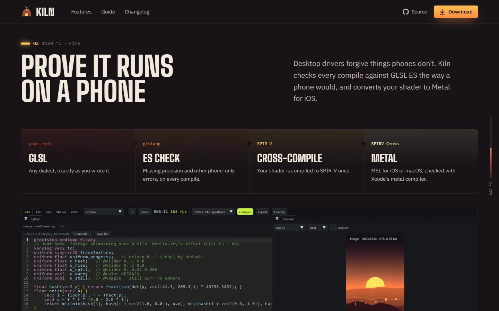
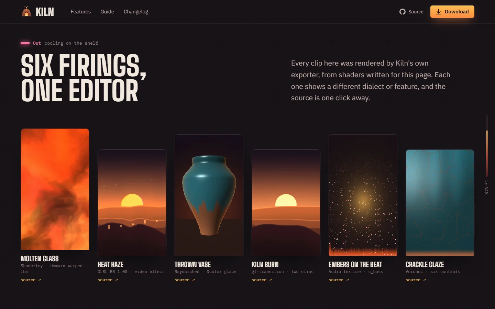
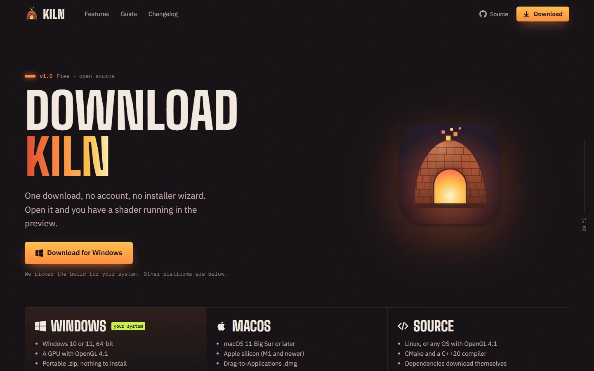
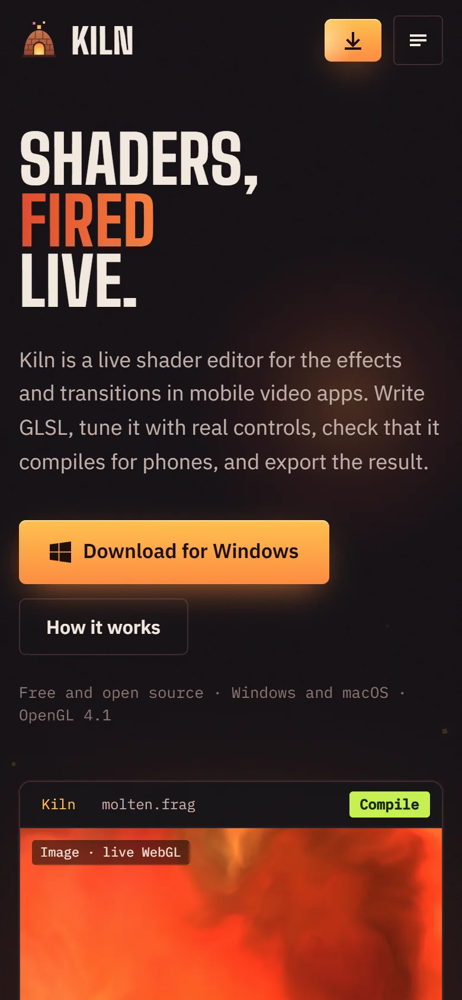
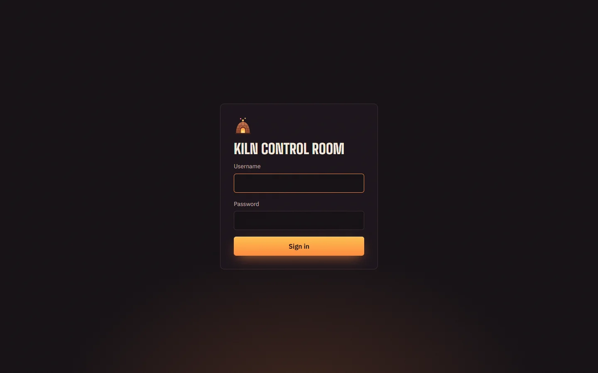

<p align="center"></p>

<h1 align="center">kiln-website</h1>

<p align="center">
  The marketing and download site for <a href="https://github.com/muhammadhassan2/Kiln">Kiln</a>, the live shader editor for mobile video effects and transitions.<br>
  <strong><a href="https://kiln-website-kohl.vercel.app">kiln-website-kohl.vercel.app</a></strong>
</p>



Next.js 16 (App Router) on Node.js, deployed on Vercel. Anonymous first-party analytics go to Supabase, and a password-protected dashboard shows them.

## What's on the site

The home page tells one story: an effect goes from idea to a file you can ship, in four firing stages. Every picture on it is real Kiln output: window captures of the app, and clips rendered by Kiln's own exporter.

| | |
|---|---|
|  |  |
| **01 Load.** Bring the shader you already have: GLSL ES, Shadertoy, gl-transitions, `#version 300 es`, desktop GLSL. | **03 Fire.** Prove it runs on a phone: the ES check and the conversion to Metal. |
|  |  |
| **The shelf.** Six exports from Kiln, each showing a different dialect or feature. | **Download.** One button for your OS, every platform below it, first-run steps and an FAQ. |

<p align="center"></p>

| Route | What it is |
|---|---|
| `/` | Live WebGL hero running `examples/molten.frag` with working `@slider` / `@color` controls, then Load → Shape → Fire → Ship, the shelf of exports, and the rest of the toolbox |
| `/download` | OS-detected download button, Windows / macOS / source, the first five minutes on each OS, build from source, FAQ |
| `/features` | Every feature grouped by stage, each group with a screenshot from the app |
| `/guide` | First effect, uniform controls, built-in uniforms, textures and audio, multipass, transitions, export, shortcuts, headless runs |
| `/changelog` | Release notes |
| `/admin` | Analytics dashboard behind a username and password |

Click any app screenshot on the site to see it full size.

## Analytics and the admin dashboard



**What's recorded.**
- `POST /api/track` records page views, visible time on page, and clicks on any element with `data-track="name"` or an outbound link.
- `GET /api/download/:platform` (`windows`, `mac`, `mac-intel`, `source`) records the download, then redirects to the file.
- `POST /api/lead` stores emails from the "tell me when it's released" form in `leads`.

**Who counts as what** (GA4's rules):

| Term | Definition |
|---|---|
| Visitor | One browser, identified by an anonymous random id in `localStorage`. No cookies, no stored IPs. If storage is blocked, a salted IP + browser hash that rotates daily is used instead. |
| Session | Activity with no gap over 30 minutes. Rebuilt from timestamps, so it continues across tabs and midnight. |
| Engaged session | 10 s or more of visible time, 2 or more pages, a download, or a sign-up. Bounce rate is the rest. |
| Conversion | Visitors with at least one download ÷ unique visitors. |

**The dashboard** at `/admin`:
- **Header and ranges:** a live "active now" count, and 24h (hourly), 7d, 30d or 90d (daily), shown in your timezone.
- **Filters:** source, page, country, device, OS, browser, or one visitor. Click any row to apply one.
- **KPIs:** audience, engagement and conversion, each compared with the previous period.
- **Charts and tables:**
  - visitors and download clicks over time
  - a funnel and a weekday × hour heatmap
  - source quality and pages (views, visitors, entrances, visible time)
  - platforms, clicks, campaigns, geography and tech
  - a session-by-session journey log, and the sign-ups list
- **Exclusion:** "Don't count my visits" keeps your own browsing out of the numbers.

Bots and headless browsers are filtered by user agent. Ad links can carry `?utm_source=…&utm_campaign=…` (or `?ref=…`).

Tables: [`supabase/schema.sql`](supabase/schema.sql), then [`supabase/migrations/`](supabase/migrations) in order. Row level security is on with no policies, so only the server (service role key) can read or write them.

## Where the pictures come from

| Folder | What's in it | How it was made |
|---|---|---|
| [`shaders/`](shaders) | Six shaders written for the site: dusk dunes, heat haze (GLSL ES video effect), crackle glaze, raymarched vase, burn transition (gl-transition), audio-reactive embers | By hand, in Kiln |
| `public/shots/` | Screenshots of the real Kiln window running those shaders | Captured from the app |
| `public/media/` | 540×960 MP4 loops and posters | Kiln's exporter: `KILN_EXPORT=clip.mp4 Kiln shader.frag` |
| `docs/screenshots/` | The screenshots in this README | The live site |

The hero runs Kiln's own [`examples/molten.frag`](https://github.com/muhammadhassan2/Kiln/blob/main/examples/molten.frag) in WebGL, wrapped the same way Kiln wraps a Shadertoy `mainImage()`.

## Run locally

```bash
npm install
cp .env.example .env.local   # fill in the values
npm run dev                  # http://localhost:3000
```

Without the Supabase variables the site works normally and records nothing.

## Environment

| Variable | Used for |
|---|---|
| `SUPABASE_URL`, `SUPABASE_SERVICE_ROLE_KEY` | Writing and reading analytics (server only) |
| `ADMIN_USERNAME`, `ADMIN_PASSWORD` | The `/admin` login |
| `ADMIN_SECRET` | Signs the admin cookie and salts visitor hashes (16+ characters) |
| `DOWNLOAD_URL_WINDOWS`, `DOWNLOAD_URL_MAC`, `DOWNLOAD_URL_MAC_INTEL` | Where the download buttons point; empty means the GitHub releases page |
| `NEXT_PUBLIC_SITE_URL` | Canonical URL when not on Vercel (on Vercel the production domain is used automatically) |

See [`.env.example`](.env.example).

## Deploy

The project is connected to Vercel, so every push to `main` deploys to production. To set it up somewhere new: import the repo on Vercel (Next.js preset, root `./`), add the variables above, run `supabase/schema.sql` and then each file in `supabase/migrations/` in the Supabase SQL editor, and deploy.

## Design

Colours follow a kiln's firing temperatures (soot, brick, cherry, ember, flame, white heat). Section markers are temperatures, and the scroll gauge heats from 20 °C to 1300 °C. The square sparks come from the app icon, and the lime is Kiln's own Compile button. Fonts are Big Shoulders (self-hosted), IBM Plex Sans and IBM Plex Mono. All motion respects `prefers-reduced-motion`.
